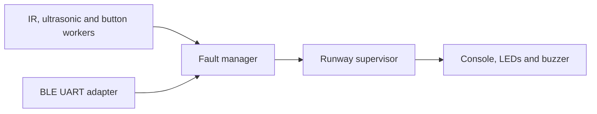

# RunwaySentinel

RunwaySentinel is a QNX Neutrino tabletop runway demonstrator for Raspberry Pi 4.
It combines physical detections and BLE tag observations for two model aircraft
(`AC1`, `AC2`) and one ground vehicle (`GV1`). The supervisor tracks occupancy
and drives four status LEDs and a buzzer when it confirms a conflict.
Use this project on the model runway.

## Architecture



| Process | Source | Responsibility |
|---|---|---|
| Sensor adapter | [`runway_sensors.c`](runway_sensors.c) | Runs the IR gate, ultrasonic, and vehicle button workers in one process. Reports crossing events and range samples. |
| BLE UART adapter | [`runway_ble_uart.c`](runway_ble_uart.c) | Reads BLE HCI advertising reports over UART and publishes tag observations. Also provides explicit operator commands. |
| Fault manager | [`runway_fault_manager.c`](runway_fault_manager.c) | Checks message format, time, sequence, session, and configured BLE identity. Tracks rejections and forwards validated reports to the supervisor. |
| Runway supervisor | [`runway_supervisor.c`](runway_supervisor.c) | Associates observations with tracks, updates occupancy and advisories, and drives the LED and buzzer panel. |

The adapters and the forwarder use named QNX channels with
`name_open`, `name_attach`, `MsgSend`, `MsgReceive`, `MsgReply`, and
`MsgError`. Timeouts use `TimerTimeout`, and report timestamps use a monotonic
clock. The [IPC headers](runway_ipc.h) and [fault protocol](runway_fault_ipc.h)
define the shared wire formats. The optional
[`runway_faultctl`](runway_faultctl.c) executable runs tests on demand. Normal
operation uses the four processes in the table.

## Build and run

Open an initialized QNX SDP shell on the build host and run:

```sh
make
```

The Makefile uses `qcc -Vgcc_ntoaarch64le` by default. Copy the rebuilt
executables to the Pi. The target BSP must expose the GPIO devices under
`/dev/gpio` and the BLE controller over an HCI UART. Use the same revision
for all four programs, since the supervisor and fault manager verify their
protocol compatibility.

Start with the model runway empty and both IR beams clear. In separate QNX
terminals, run the following commands from the directory containing the
executables.

| Order | Command |
|---|---|
| 1 | `./runway_supervisor` |
| 2 | `./runway_fault_manager` |
| 3 | `./runway_sensors 17 27 23 24 22 25 0 0 600 400` |
| 4 | `./runway_ble_uart` |

The sensor command lists example BCM pins, two IR active levels, and two
zone thresholds in millimetres. Replace the example values with the model's
wiring and thresholds. Keep stable background echoes during startup so the
supervisor can calibrate both ultrasonic channels.

```text
IR1 IR2 AIR_TRIG AIR_ECHO GV_TRIG GV_ECHO IR1_ACTIVE IR2_ACTIVE AIR_ZONE_MM GV_ZONE_MM
```

The BLE scanner defaults to `/dev/ser4`. For a different wired UART, use
`./runway_ble_uart /dev/serN --continuous --ipc`. To check local input
handling, use `./runway_sensors --self-test` and
`./runway_ble_uart --self-test`. Prefix the sensor wiring arguments with
`--local` to observe live GPIO without sending reports.

## Hardware and demo

| Output or control | BCM GPIO |
|---|---:|
| Vehicle entry button | 5 |
| Vehicle exit button | 6 |
| Clear LED | 13 |
| Occupied LED | 19 |
| Verify LED | 16 |
| Conflict LED | 26 |
| Active-high buzzer | 12 |

The vehicle buttons are active high with pull-downs. On the taxiway gate,
blocking IR2 and then IR1 and completing the crossing reports entry. The
reverse direction reports exit. Aircraft association also uses BLE and
ultrasonic evidence.

1. Start with a clear model runway and wait for the supervisor to show clear.
2. Bring AC1 through the taxiway gate and into the aircraft ultrasonic beam.
   Check its track and the occupied indication.
3. While AC1 remains on the strip, move GV1 into the vehicle sensor zone and
   press the vehicle entry button. A confirmed shared occupancy activates the
   conflict LED and buzzer.
4. Move one object off the runway and complete its exit event. Observe the
   supervisor's updated occupancy and alert state.

## Fault tests on the model

For fault tests, start the fault manager with `--test --details`. For the
identity test, also register the real AC1 advertiser using
`'AC1=0,AA:BB:CC:DD:EE:01'` with the tag's actual address and address type.
Run `./runway_ble_uart /dev/ser4 10` in local monitor mode before starting
the continuous scanner to inspect advertiser addresses.

| Test | Command | What to check |
|---|---|---|
| Delayed sample | `./runway_faultctl delay 1500` | The next valid aircraft range frame arrives with its original timestamp and is rejected as stale. Later samples can still flow. |
| Duplicate event | `./runway_faultctl replay-button` | A fresh button event is replayed and rejected as a duplicate. If there is no fresh event, press a vehicle button to test the next event. |
| Conflicting identity | `./runway_faultctl identity-ac1` | A different BLE address claims AC1 and is rejected. The test requires an AC1 address registered on the fault manager. |
| CPU load | `./runway_faultctl load-cpu 10 4` | Lower-priority workers run for ten seconds. Trigger a real model conflict during the test and record alert latency and deadline misses from the supervisor. |

Check the fault-manager rejection count and the supervisor's track IDs
through each test. For an already confirmed conflict, check that a rejected
report leaves the alert active. Use fresh, valid observations to demonstrate
normal recovery and conflict clearance.

## Timing, monitoring, and recovery

- **Freshness.** The maximum accepted age is 1,000 ms for sensor and button
  messages and 3,000 ms for BLE observations. A fresh `No echo` is a valid
  measurement result. IR and button rows show time since the last event.
- **Priority.** The supervisor and forwarding threads request FIFO priority 30.
  The IR and intake threads request FIFO 24, and the button thread requests
  FIFO 23. The range and BLE work requests round-robin 20 and 18, respectively.
  Console threads request round-robin 10. The effective priorities depend on
  target permissions and QNX message priority inheritance.
- **Health.** The fault-manager console displays sequence, age, status, and
  rejections. With `--details`, it also shows capture times and recent errors.
  Worker heartbeat monitoring runs inside the fault manager and can report a
  worker stall after a worker has been seen.
- **Alert latency.** The supervisor measures from conflict determination to
  successful GPIO commands for the warning outputs. It counts misses against a
  100 ms demo target. The measurement ends at software GPIO completion.
- **Recovery.** If the supervisor loses its range registration, the fault
  manager can renegotiate the range link and resend a fresh sample with its
  original timestamp and sequence. On process restart, clear the model and
  restart the full chain in the documented order to republish ready messages
  and calibrate the ultrasonic channels.

The hardware demonstration estimates radial motion from ultrasonic range
samples. Full simulated position feeds, track-association scoring, and
on-target timing measurements are separate from this source package.
